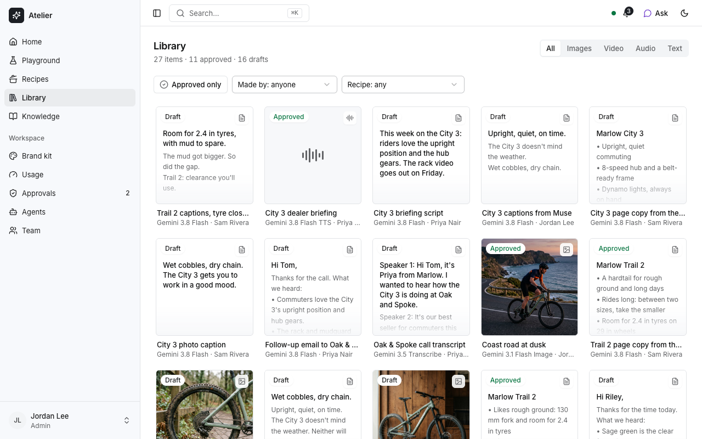

# Atelier

An AI studio for a business team: try every Xano AI model, save what works as recipes, keep everything you make, ask your own documents, and stay inside a budget.

**Starter template**

`29 tables · 103 endpoints · 13 screens · auth: @xano-sdk/auth`



Atelier is a working AI studio a team can use on day one. A content team writes product copy, makes product photos, short clips, voiceovers and music beds, and asks questions of its own brand guides and customer calls. Every output lands in a Library with how it was made: the prompt, the model, the settings, who made it and what it cost. Admins set a monthly budget for the team and for each person, and approve runs above a line they choose.

It is also a reference. Every model call in it is one of Xano's AI statements (text, image, video, speech, music, transcription, embedding and rerank), and each takes a few lines of backend code you can read.

The backend under [`xano/`](xano/) is TypeScript, written with the [Xano SDK](https://github.com/xano-sdk/sdk). It runs on your machine as the Xano Engine, and on Xano's cloud with the same command. The React frontend under [`frontend/`](frontend/) takes its request paths and types from the backend.

## Quick start

```sh
git clone https://github.com/xano-community/atelier-ai-studio
cd atelier-ai-studio
npm install
```

Then run it one of two ways:

- **On your machine, no account.** `npm run xano:deploy` deploys and seeds the backend on the Xano Engine on your machine. Then `npm run dev` opens the app. Everything seeded is browsable. To run models, sign in once with `npx @xano/sdk login` before you deploy: model calls use your Xano AI credits.
- **On a cloud link** (works with ChatGPT and Claude). Run `npx @xano/sdk login` once, then `npm run xano:deploy:ephemeral`. It prints a live URL.

Then click **Continue as Jordan Lee**.

The demo is Marlow, a bike brand's in-house marketing team, two weeks into an autumn launch:

| Persona | Role | Who they are |
|---|---|---|
| **Jordan Lee** | admin | Head of brand. Sets the budgets and approves costly runs. Two runs wait for Jordan |
| **Sam Rivera** | member | Content lead. Runs recipes and makes launch assets |
| **Priya Nair** | member | Customer insights. Adds call recordings to Knowledge |
| **Alex Kim** | guest | Freelance designer. Sees approved work and can ask Knowledge |

## What you can do

**As Jordan, the first minute:**

1. Home shows the month: what the team spent against its budget, runs this week, the Library and Knowledge. A sample clip is finishing under **Running now**. It was made before the deploy, so it calls no model and costs nothing.
2. Open **Recipes**, pick **Product page copy and photo**, type a product and press **Run**. It writes the copy, then makes a studio photo from it. It runs on the Free plan.
3. Open **Library**. The copy and the photo are there as drafts, each with its prompt, model, cost, maker and run. Press **Approve for use**.
4. Open **Knowledge** and ask "What do riders say about Trail 2 sizing?". The answer cites the size guide and the Halden Cycles call, and the call's citation plays from the moment it quotes.
5. Open **Usage**: the month by person, kind and model, the budgets, the approval line and the price table.

**Also try:** review Sam's **Product launch kit: City 3** under **Running now** and approve it. Open the **Playground**, pick **Image**, and press **Compare** to run two models on one prompt. Sign in as Alex and see only approved work. Open Atelier in a second window as Sam and watch a run you start move in both.

## Agents

### Easel, in the app

**Ask** in the header opens Easel, the in-app assistant, for admins and members. Guests don't get it. Easel uses the same eight tools as outside agents: list and run recipes, generate any kind of output, ask Knowledge, find and read Library items, check a run, and see your spend. It can also say what changed lately, list your unread notifications, and check on an approval. Everything it starts is a run of your own, under your budget, and a member's video still waits for an admin.

Easel needs a model key. It runs Gemini 4 Hydrogen on your own Google key by default, or Claude on an Anthropic key. The code also has a `xano-ai` setting that would run Easel on Gemini 4 Hydrogen through Xano AI with no key of its own, but Xano AI refuses an agent with tools today, so Easel's replies fail with it. Use `google-genai` or `anthropic`. Set these in `xano/.env` and deploy again, or set them on a running backend with `npx @xano/sdk env set`:

```sh
AGENT_PROVIDER=google-genai       # or anthropic
GEMINI_API_KEY=...                # with google-genai (model: GEMINI_MODEL, default gemini-4-hydrogen)
ANTHROPIC_API_KEY=sk-ant-...      # with anthropic (model: ANTHROPIC_MODEL, default claude-opus-5-5)
```

With no key, Easel says so and names the setting. Easel's own turns are billed by that provider, not Xano credits. Usage lists them as provider-billed, and they don't count against a budget.

### Claude, ChatGPT and your own code

Open **Agents** and create a key, or sign in from ChatGPT or Claude on a cloud deploy. The MCP server offers the same eight tools, plus what changed lately, your notifications, asking to change someone's role (it waits for an admin), and checking on an approval. A key acts as the person who made it, with that person's role and budget, and is logged in the activity feed. Revoke a key and its next call is refused.

| Tool | Does | Access |
|---|---|---|
| `list_recipes` | The team's published recipes and their inputs | read |
| `run_recipe` | Starts a recipe run and returns its id at once | write, under the spend gate |
| `generate` | One text, image, video, speech, music or transcript | write, under the spend gate |
| `ask_knowledge` | An answer from the team's sources, with citations | write (it spends), under the spend gate |
| `find_assets` · `get_asset` | Library items you may see, and one item's record | read |
| `check_run` | A run's status, steps and outputs | read |
| `my_usage` | Your spend this month and what's left | read |

Each recipe also has an HTTP endpoint, `POST /api:studio/recipes/{slug}/run`, called with your agent key. The recipe's **API** tab shows the call in cURL or JavaScript, and makes and revokes your keys. A repeat with the same `Idempotency-Key` returns the first run.

## Built in

- **Live updates.** Runs move on every open screen, and a run finished elsewhere appears without a reload. Runs publish ids only.
- **Notifications.** The bell rings when your run ends, a source is ready, or a run waits for your approval.
- **⌘K and shortcuts.** Jump anywhere, run an action, or find a Library item by title. `?` lists the shortcuts.
- **Easel**, the assistant, on every screen for admins and members.
- **Approvals.** Runs that wait for an admin, and role changes an agent asked for, are approved or declined in one place.
- **Invites and resets.** An admin invites a teammate from **Team** with a one-time link, or makes a password-reset link. No email is sent: you copy the link and pass it on.
- **Settings and activity.** Rename the workspace, and see what people and their agents did.

## How spending works

- **Estimates, not the bill.** Xano AI returns what a call used (tokens, seconds, images), not what it cost. Atelier prices that usage with its own `price` table and labels every figure "about". Admins edit the prices under **Usage**. A model with no price is refused with words an admin can act on, never run for free. The gateway's own bill is in your Xano account.
- **Reserve, call, settle.** Before a call, its estimate is reserved against the team's and the person's monthly budget. After it, the reservation becomes the charge for what was used, or is released if nothing was sent. A step that times out after it was sent is charged, because the gateway bills it.
- **Budgets.** The demo starts with $100 a month for the team and $25 for each person. A run that would go over either is refused before any call, with **Ask an admin**. An admin can let it through once.
- **Approvals.** A member's run estimated above the approval line ($0.50 to start), and every video by a member, waits for an admin. An admin's own run above the line asks for one confirming click.
- **Repeats are free.** Every run-starting request carries a key. A double click, a client retry or an agent calling a tool twice returns the first run.
- **The Free plan.** Text, images, transcription, Knowledge and Ask run on Free. Video, music and speech files need a paid plan to store, and Atelier says so before a run starts.

## API surface

Every route needs a signed-in person unless marked. "Member" means admin or member.

| Verb · path | Who | What it enforces |
|---|---|---|
| `POST /api:studio/runs` | member | The spend gate, the approval line, a run key; returns the run at once |
| `GET /api:studio/runs/{id}` | the owner and admins, or anyone for a team run | Private Playground runs stay private |
| `POST /api:studio/runs/{id}/stop` · `/retry` · `/confirm` · `/ask-admin` | the owner | Retry re-runs only failed steps |
| `POST /api:studio/runs/{id}/raise-budget` | admin | Lets one refused run go over a budget |
| `GET /api:studio/runs/{id}/details` | anyone who may read the run | The run's recipe, inputs, owner, key name and approval |
| `GET /api:studio/playground/catalog` · `POST /playground/estimate` · `GET /playground/history` | member | The live model list, checked on the server |
| `POST /api:studio/playground/steps/{id}/use` | the run's owner | Puts a Playground output in the team's Library |
| `GET · POST /api:studio/recipes`, `GET /recipes/{slug}`, `PATCH · DELETE /recipes/{id}` | member | A step may use only inputs and earlier steps |
| `POST /api:studio/recipes/estimate` · `POST · GET /recipes/{id}/runs` | member | Runs a recipe from the app, or lists its 25 latest runs |
| `POST /api:studio/recipes/{slug}/run` · `GET /recipes/runs/{id}` | a person's own agent key; running needs read and write | The same gate as the app; `Idempotency-Key` |
| `GET · POST /api:studio/keys`, `POST /keys/{id}/revoke` | member | Your own keys for the recipe API; a key is shown once |
| `GET /api:library/assets` · `/assets/{id}` · `/facets` | everyone; guests see approved items only | A draft is a 404 to a guest |
| `POST /api:library/assets/{id}/approve` | member | Records who approved it and when |
| `DELETE /api:library/assets/{id}` | the maker, or an admin | Deletes the item and its file |
| `GET /api:library/assets/{id}/link` · `/text` · `/media/{id}` | whoever may see the item | Signed links last a minute |
| `POST /api:knowledge/sources` · `/sources/{id}/retry`, `DELETE /sources/{id}` | member | PDFs and recordings up to 20 MB, text up to 2 MB |
| `GET /api:knowledge/sources` · `/sources/{id}` · `/sources/{id}/audio` · `POST /api:knowledge/ask` | everyone | Answers cite only the passages they were given |
| `GET /api:knowledge/questions` | everyone | Your own questions only |
| `GET · PUT /api:settings/brand`, brand images | member edits, everyone reads | Applied to text, image and video prompts |
| `GET /api:studio/usage` · `/budgets`, `PATCH /budgets`, `POST /budgets/people/{id}`, `PATCH /api:settings/prices/{id}` | admin | Totals add up to the settled ledger |
| `POST /api:studio/ai-status` · `/ai-status/check` · `/storage-check` | admin | Whether Xano AI runs here, and which files this plan keeps |
| `GET /api:studio/home` · `/ai-state` · `/easel`, `GET /api:settings/prices` | everyone | What this person may see |
| `POST /api:studio-loop/steps/execute` | the background worker's two-minute token | Runs one step after the response |

The base app adds sign-in, invites, team, settings, notifications, activity, approvals and agent keys (`/api:authn`, `/api:app`, `/api:rbac`, `/api:approvals`, `/api:agent`). Easel's chat is under `/api:chat`, and the ChatGPT and Claude sign-in under `/api:mcp-oauth-ai-studio`. `npx @xano/sdk routes ./xano/index.ts` prints every route.

## Repo layout

The app's own files:

- `xano/app.ts` (name, roles, demo people), `xano/rbac.ts` (who may do what), `xano/approvals.ts` (what waits for an admin)
- `xano/domain.ts` registers everything below
- `xano/function/ai/` one wrapper per AI statement, and the only code that calls a model
- `xano/function/runs/` and `xano/function/spend/` the runs and the spend gate
- `xano/function/knowledge/`, `library/`, `recipes/`, `brand/`, `studio/` the rest of the domain
- `xano/tools/` the MCP tools and Easel's tools, thin wrappers over `xano/function/studio/`
- `xano/prices.ts` and `xano/catalog.gen.json` the price table and the model catalog
- `xano/world.ts` the Marlow demo world; `xano/production.ts` the same backend with no demo rows
- `frontend/src/app.config.tsx` the screens, nav and ⌘K actions; `frontend/src/pages/` and `frontend/src/lib/`
- `frontend/scripts/` the checks behind `npm run qa:*`

The base app's: `xano/base/`, `frontend/src/base/`, `frontend/src/components/kit/`.

## Extend it

### Add a step kind to recipes

Recipes run any kind the Playground has. To add one the app already wraps (embedding, say):

1. Add it to `RECIPE_STEP_KINDS` in `xano/table/recipes/recipe_step.ts`.
2. Give it a label and defaults in `frontend/src/lib/recipes.ts` (`KIND_LABEL`, `newStep`), and an icon in `frontend/src/components/studio/kind-icon.tsx`.
3. Say where an earlier step's file goes in what it sends to the model, in `xano/function/recipes/plan.ts`, and add a workflow test to `xano/test/recipes.ts`.

### Add a statement when Xano ships one

1. `npm run catalog:sync` writes the new models into `xano/catalog.gen.json`. Add their prices to `xano/prices.ts`.
2. Write the wrapper in `xano/function/ai/<kind>.ts`, copying `text.ts`: it takes a reserved step id, calls the statement, and maps errors through `gateway.ts`.
3. Add the kind to `STEP_KINDS` in `xano/table/studio/ai_step.ts`, its case in the switch in `xano/function/runs/execute_step.ts`, and how its output is kept in `xano/function/library/store.ts`.
4. Add a Playground tab in `frontend/src/pages/playground/`, and a unit test in `xano/test/steps.ts`. `npm run qa:ai-calls` checks that no other code calls the model.

## Going to production

The demo is for trying Atelier. For real use, deploy the production entry. `xano/production.ts` is the same backend with every demo row taken out: no Marlow, no demo people and no demo sign-in. It keeps the price table.

1. **Set a setup token.** Put a long random value in `xano/.env`, which git ignores. Whoever holds it can create the first admin, so keep it private:

   ```sh
   echo "SETUP_TOKEN=$(openssl rand -hex 24)" >> xano/.env
   ```

2. **Deploy.** `npm run xano:deploy:production` deploys to the Engine on your machine. Add `-- --ephemeral` for a cloud environment.
3. **Create the first admin.** Open the app. An empty backend shows the setup page. Enter your name, email, password and the setup token. The budgets start at $100 a month for the team and $25 each, with approval above $0.50. Change them under **Usage**.
4. **Set a model key for Easel**, as in [Easel, in the app](#easel-in-the-app).
5. **Turn on ChatGPT and Claude sign-in.** After the first cloud deploy, set the sign-in page's address, the backend URL followed by `/api:mcp-oauth-ai-studio/mcp_oauth/login`:

   ```sh
   printf %s "$URL" | npx @xano/sdk env set MCP_OAUTH_LOGIN_URL
   ```

6. **Move to your Xano workspace through a release.** Deploy the production entry to an ephemeral, cut a release with `npx @xano/sdk release create <name> --from ephemeral`, then land it with `npx @xano/sdk promote <name> --set-live`.

> **Never cut a release with `--seed` from a demo deploy.** `--seed` copies table rows into the release. From `npm run xano:deploy` or `npm run xano:deploy:ephemeral`, those rows are the Marlow demo and its people, with their one-click sign-in. Cut releases from a production deploy.

## Where it runs

- **The Xano Engine on your machine** runs the whole app. Model calls run once you sign in with `npx @xano/sdk login` before you deploy. The Engine can't sign private links, so images and audio are kept in a table, and video previews need a cloud deploy.
- **A cloud deploy** (`npm run xano:deploy:ephemeral`) adds private file storage with signed links, video previews, and ChatGPT and Claude sign-in.
- **The AI statements need a Xano instance with Xano AI.** Without it, the app still runs, shows a notice with the reason, and keeps model calls off. Rerank also needs a model in the catalog with a price, as below.
- **Easel** runs on any of these with a Google or Anthropic key.

## Limits

- **Rerank needs a priced model.** Without one in the catalog, Ask keeps the closest passages in similarity order and says "ranked by similarity". It uses rerank when the catalog lists a rerank model with a price.
- **The Engine on your machine can't sign private links.** Images and audio are kept in a table and served through an authed route. Video previews need a cloud deploy.
- **Easel needs your own Google or Anthropic key.** Xano AI doesn't run agents with tools, so `AGENT_PROVIDER=xano-ai` doesn't work.
- **The Free plan can't store video, music or speech files.** Those steps say "needs a paid plan" before they run.
- **Estimates are not the bill.** They come from Atelier's price table. Prices change: several text models list a rise in January. Edit the table under **Usage**.
- **Live updates carry ids only.** Each screen fetches what its person may see. Text isn't streamed token by token.
- **Knowledge files:** PDFs and recordings up to 20 MB, text up to 2 MB, PDFs up to 50 pages. A source whose embedding failed can be retried and keeps what was read. A source that couldn't be read is added again by uploading it again.
- **Strict export reports 28 findings in module code.** `npm run xano:check` stops on null-safety warnings inside the published `@xano-sdk/agents` (approvals and agent access), `@xano-sdk/rbac` and `@xano-sdk/chatbot` packages and their tests under SDK 1.0.21. The app's own code adds none. Deploys aren't affected.
- Not built: streaming text, video editing or joining clips, document-level permissions on Knowledge, and Content Credentials signing. Library items carry an "AI-generated" label and their full record instead.

## Run it and test it

- `npm run xano:deploy` deploys to the Engine and keeps your rows. Add `-- --test` to run the backend's tests after it.
- `npm run xano:test` runs the deployed backend's tests. `npm test` runs the frontend and seed tests.
- `npm run xano:check` is the CI gate: fresh routes, the typecheck and a strict export.
- `npm run qa:<name> -- --backend <url>` runs a check against a deploy (the browser checks also take `--app <frontend url>`; each script's first lines say what it takes). `first-run`, `spend` and `ai-calls` need no model; `playground`, `recipes`, `knowledge`, `steps`, `library` and `assistant` spend real credits, a few cents each, and say how much.
- `npm run catalog:sync` refreshes the model catalog and flags prices that changed.
- `npm run seed:vectors` embeds the seeded Knowledge passages and writes `xano/seed-vectors.json`, so a deploy has working Knowledge with no model call. Run it after changing a seeded passage. It needs a Xano sign-in with AI.
- `npm run xano:deploy:frontend` builds the frontend and publishes it on its own.

**Backend settings.** They live in `xano/.env`, which git ignores; `xano/.env.example` lists the names. All may stay empty for the demo.

| Name | What it does |
|---|---|
| `AGENT_PROVIDER` | Easel's model provider: `google-genai` (the default) or `anthropic` |
| `GEMINI_API_KEY` · `GEMINI_MODEL` | Easel on Google. The model defaults to `gemini-4-hydrogen` |
| `ANTHROPIC_API_KEY` · `ANTHROPIC_MODEL` | Easel on Anthropic. The model defaults to `claude-opus-5-5` |
| `SETUP_TOKEN` | Lets the first admin set up a production deploy. Empty turns setup off |
| `MCP_OAUTH_LOGIN_URL` | The ChatGPT and Claude sign-in page, set after the first cloud deploy |
| `XANO_AI_DEPLOY` | Written by the deploy scripts after each deploy: whether Xano AI runs here. Don't set it by hand |

**The one contract.** `frontend/src/lib/api.ts` takes request paths from `xano/routes.gen.ts` and response types from the backend with `import type`. Change the backend and the frontend follows.

**`xano/xano.lock`: commit it.** It freezes each object's identity and each API group's path across deploys.

## FAQ

- **Do I need a Xano account to try it?** No. The seeded studio is browsable on the Engine with no account. Running models needs a Xano sign-in with AI credits.
- **Who pays for model calls?** On your machine, the person signed in with `npx @xano/sdk login`. On a cloud deploy, the instance owner. `npm run xano:deploy` prints which.
- **Can a member spend the whole budget?** No. Each person has a monthly budget of their own inside the team's, and runs above the approval line wait for an admin.
- **Can an agent run up costs?** It acts as the person whose key it holds, with their budget and approvals. A member's agent can't approve its own video.
- **Can I use my own model keys for the statements?** No. The statements run on Xano AI credits. Easel is the exception, as above.

<!-- BEGIN:xanosdk-built-with -->
<!-- xanosdk 1.0.22 — generated; edits inside this block are overwritten -->

## Built with

- [Xano](https://xano.com) hosts everything under [`xano/`](xano/): the database, APIs,
  auth, background tasks, realtime, file storage and AI agents. It runs on your machine as
  the Xano Engine and in the cloud from the same command. [Docs](https://docs.xano.com) ·
  [Community](https://community.xano.com)
- [Xano SDK](https://github.com/xano-sdk/sdk) is the TypeScript the backend is authored in.
  The [guides](https://github.com/xano-sdk/sdk/blob/main/guides/README.md) cover signing in
  and deploying, releasing to production, the typed frontend, and every CLI command.
<!-- END:xanosdk-built-with -->
